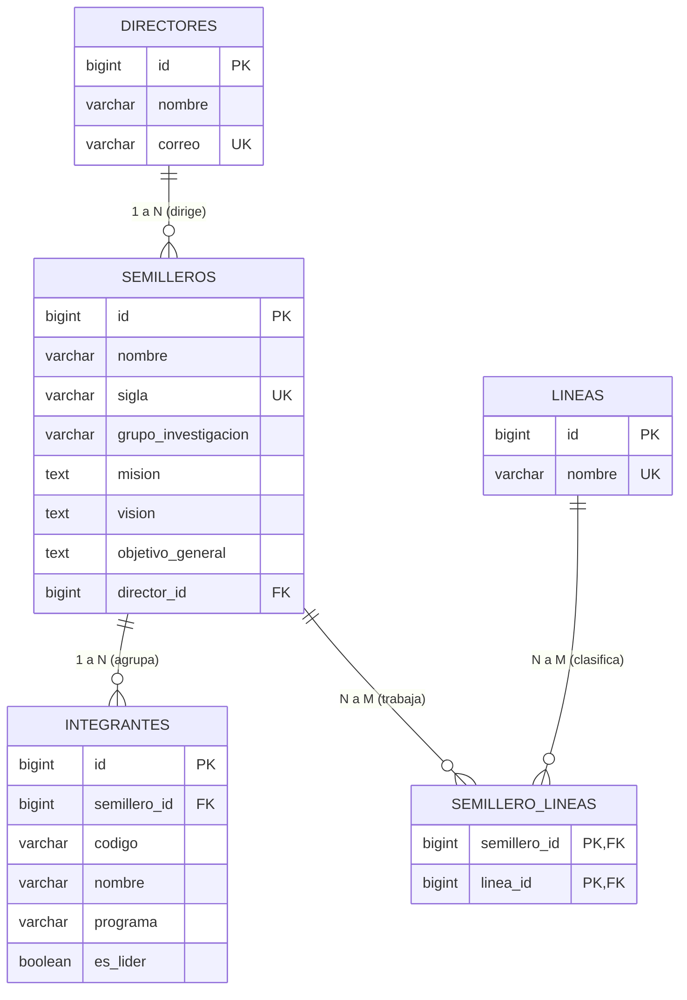

# Laboratorio: Registro Transaccional de Semilleros de Investigación


Este proyecto implementa una **API REST transaccional** desarrollada en **Spring Boot** para el registro atómico de semilleros de investigación, sus docentes directores, líneas de investigación e integrantes estudiantiles en una única petición HTTP.

Basado en el caso de estudio institucional **SIAWEB**, este laboratorio asegura que cualquier fallo o incumplimiento de reglas de negocio aborta la operación completa mediante `@Transactional` (rollback automático), impidiendo estados inconsistentes o registros huérfanos.

---

## 1. Arquitectura y Flujo de Datos

El diseño del sistema sigue una separación estricta de responsabilidades:

```text
HTTP Request (JSON)
       │
       ▼
[@RestController: SemilleroController]
       │  (Jackson deserializa y Bean Validation valida con @Valid)
       ▼
[SemilleroRequest DTO]
       │
       ▼
[@Service @Transactional: SemilleroService]
  ├── 1. Valida unicidad de sigla (R1) -> 409 Conflict
  ├── 2. Valida al menos una línea (R3) -> 400 Bad Request
  ├── 3. Valida al menos un integrante (R4) -> 400 Bad Request
  ├── 4. Valida exactamente un líder (R6) -> 400 Bad Request
  ├── 5. Valida códigos estudiantiles únicos (R5) -> 400 Bad Request
  ├── 6. Mapea DTOs a Entidades con MapStruct
  ├── 7. Persiste Director, Semillero, Líneas e Integrantes
       │
       ├──► [JpaRepository / Hibernate]
       │           │
       │           ▼
       │      [(PostgreSQL)] (DDL validado contra Flyway V1)
       │
       ▼
[SemilleroResponse DTO (201 Created)]
       │
       ▼
HTTP Response (JSON)
```

---

## 2. Modelo Relacional y Migraciones Flyway

El esquema se versiona mediante **Flyway** en `src/main/resources/db/migration/`:
- `V1__crear_estructura.sql`: Creación de tablas (`directores`, `semilleros`, `lineas`, `semillero_lineas`, `integrantes`), claves foráneas, restricciones de unicidad e índice parcial.
- `V2__datos_prueba.sql`: Carga inicial de datos de prueba (semilleros institucionales `SIAWEB` y `SIABD`, directores, líneas e integrantes cumpliendo todas las reglas de negocio).

Hibernate opera con `spring.jpa.hibernate.ddl-auto=validate`.



### Restricciones y Reglas en BD:
1. `directores`: `correo` es `UNIQUE NOT NULL`.
2. `semilleros`: `sigla` es `UNIQUE NOT NULL`. `director_id` es clave foránea obligatoria.
3. `lineas`: `nombre` es `UNIQUE NOT NULL`.
4. `semillero_lineas`: Clave primaria compuesta (`semillero_id`, `linea_id`), ambas claves foráneas.
5. `integrantes`: Clave foránea `semillero_id` (`ON DELETE CASCADE`), y unicidad por semillero y código:
   `CONSTRAINT uq_integrante_semillero_codigo UNIQUE (semillero_id, codigo)`.
6. **Índice parcial de PostgreSQL**: Refuerza a nivel físico que nunca exista más de un líder en un mismo semillero:
   ```sql
   CREATE UNIQUE INDEX uq_semillero_un_lider ON integrantes (semillero_id) WHERE es_lider = true;
   ```

---

## 3. Estructura de Paquetes

```text
src/main/java/com/example/demo/
├── DemoApplication.java
├── StatusController.java
├── controller/
│   └── SemilleroController.java
├── dto/
│   ├── request/
│   │   ├── DirectorRequest.java
│   │   ├── IntegranteRequest.java
│   │   └── SemilleroRequest.java
│   └── response/
│       ├── ErrorResponse.java
│       └── SemilleroResponse.java
├── entity/
│   ├── Director.java
│   ├── Integrante.java
│   ├── Linea.java
│   └── Semillero.java
├── exception/
│   ├── GlobalExceptionHandler.java
│   ├── ReglaNegocioException.java
│   └── SiglaDuplicadaException.java
├── mapper/
│   ├── DirectorMapper.java
│   ├── IntegranteMapper.java
│   ├── ManualMapper.java
│   └── SemilleroMapper.java
├── repository/
│   ├── DirectorRepository.java
│   ├── IntegranteRepository.java
│   ├── LineaRepository.java
│   └── SemilleroRepository.java
└── service/
    └── SemilleroService.java
```

---

## 4. Configuración y Ejecución

### 4.1 Requisitos
- **Java Development Kit (JDK)**: versión 21 o superior.
- **PostgreSQL**: versión 15 o superior ejecutándose en `localhost:5432`.
- Base de datos creada: `semilleros_db`.

### 4.2 Variables de Configuración (`application.properties`)
El archivo de propiedades utiliza variables de entorno con valores por defecto locales:

```properties
spring.application.name=demo

spring.datasource.url=${SPRING_DATASOURCE_URL:${DB_URL:jdbc:postgresql://localhost:5432/semilleros_db}}
spring.datasource.username=${SPRING_DATASOURCE_USERNAME:${DB_USER:postgres}}
spring.datasource.password=${SPRING_DATASOURCE_PASSWORD:${DB_PASSWORD:1234}}
spring.datasource.driver-class-name=org.postgresql.Driver

spring.jpa.hibernate.ddl-auto=validate
spring.flyway.enabled=true
spring.flyway.baseline-on-migrate=true
spring.flyway.baseline-version=0
spring.jpa.open-in-view=false
```

### 4.3 Comandos de Ejecución

**Ejecutar pruebas unitarias e integración (T1 a T7):**
```bash
./mvnw clean test
```

**Iniciar la aplicación:**
```bash
./mvnw spring-boot:run
```

---

## 5. Documentación Interactiva (Swagger / OpenAPI)

Una vez en ejecución la aplicación:
- **Swagger UI**: [http://localhost:8080/swagger-ui/index.html](http://localhost:8080/swagger-ui/index.html)
- **Especificación OpenAPI (JSON)**: [http://localhost:8080/v3/api-docs](http://localhost:8080/v3/api-docs)

---

## 6. Escenarios de Prueba (T1 - T7)

Se incluye el archivo de colección de Postman: [`postman_collection.json`](postman_collection.json).

### T1: Registro Válido (201 Created)
- **Endpoint**: `POST /api/semilleros`
- **Payload**:
```json
{
  "nombre": "Semillero de Aplicaciones Web",
  "sigla": "SAW-01",
  "grupoInvestigacion": "Grupo de Ingeniería de Software",
  "mision": "Promover la investigación aplicada",
  "vision": "Desarrollar soluciones universitarias",
  "objetivoGeneral": "Fortalecer competencias investigativas",
  "director": {
    "nombre": "Docente Ejemplo",
    "correo": "docente@universidad.edu"
  },
  "lineas": ["Aplicaciones Web", "Sistemas Distribuidos"],
  "integrantes": [
    { "codigo": "2026001", "nombre": "Ana Ejemplo",  "programa": "Ingeniería de Sistemas", "esLider": true },
    { "codigo": "2026002", "nombre": "Luis Ejemplo", "programa": "Ingeniería de Sistemas", "esLider": false }
  ]
}
```
- **Respuesta (201 Created)**:
```json
{
  "id": 1,
  "sigla": "SAW-01",
  "totalIntegrantes": 2,
  "estado": "REGISTRADO"
}
```

### T2: Sigla Duplicada (409 Conflict)
- Intentar registrar otro semillero con sigla `SAW-01`.
- **Respuesta (409 Conflict)**:
```json
{
  "status": 409,
  "error": "Conflict",
  "mensaje": "Ya existe un semillero registrado con la sigla: SAW-01"
}
```

### T3: Sin Integrantes (400 Bad Request)
- Enviar `"integrantes": []`.
- **Respuesta (400 Bad Request)**: Rechazado por `@NotEmpty` y validación de negocio. Ninguna escritura.

### T4: Dos Líderes (400 Bad Request)
- Enviar dos integrantes con `"esLider": true`.
- **Respuesta (400 Bad Request)**:
```json
{
  "status": 400,
  "error": "Bad Request",
  "mensaje": "Debe existir exactamente un integrante con rol de líder. Líderes encontrados: 2"
}
```

### T5: Código Estudiantil Repetido (400 Bad Request)
- Enviar dos integrantes con `"codigo": "2026999"`.
- **Respuesta (400 Bad Request)**:
```json
{
  "status": 400,
  "error": "Bad Request",
  "mensaje": "No se permiten códigos estudiantiles repetidos en el semillero: 2026999"
}
```

### T6: Correo Inválido (400 Bad Request)
- Enviar director con `"correo": "correo-sin-formato"`.
- **Respuesta (400 Bad Request)**: Error de validación Jakarta Bean Validation (`@Email`).

### T7: Atomicidad y Prueba de Rollback
- Si ocurre una excepción no controlada (`RuntimeException`) después de insertar el director, la anotación `@Transactional` revierte toda la transacción.
- **Evidencia en base de datos**:
  ```sql
  -- Estado antes del intento fallido:
  SELECT COUNT(*) FROM directores; -- Ejemplo: 1 fila
  SELECT * FROM directores WHERE correo = 'docente_huerfano_t7@universidad.edu'; -- 0 filas

  -- Se ejecuta la operación con simulación de fallo posterior al save(director):
  -- El motor JPA/PostgreSQL ejecuta ROLLBACK.

  -- Estado después del fallo:
  SELECT COUNT(*) FROM directores; -- Se mantiene idéntico (1 fila)
  SELECT * FROM directores WHERE correo = 'docente_huerfano_t7@universidad.edu'; -- 0 filas (NO queda director huérfano)
  ```

---

## 7. Comparación: Conversión Manual vs MapStruct

En la Sesión 2 de la práctica se implementaron ambos enfoques:

| Característica | Conversión Manual (`ManualMapper.java`) | MapStruct (`DirectorMapper`, `SemilleroMapper`) |
|---|---|---|
| **Mantenibilidad** | Requiere escribir y mantener código repetitivo (`setX(getX())`). | Código generado automáticamente a partir de interfaces declarativas. |
| **Tiempo de detección de errores** | Los errores de tipeo o cambios de nombres se detectan en tiempo de ejecución si se omiten setters. | Se detectan en tiempo de compilación (`javac`). |
| **Rendimiento** | Código Java directo sin reflexión (buena velocidad). | Mismo rendimiento nativo (genera código Java puro sin reflexión en compilación). |
| **Separación de responsabilidades** | Riesgo de mezclar lógica de negocio dentro de los métodos de conversión. | El mapper se enfoca exclusivamente en la transformación DTO ↔ Entity; las validaciones y reglas permanecen en el `@Service`. |

---

## 8. Respuestas a las Preguntas para Discusión

### 1. ¿Por qué no es recomendable recibir directamente una Entity en `@RequestBody`?
- **Acoplamiento del contrato externo con el modelo interno**: Cambios en la estructura de base de datos o en las entidades romperían los clientes que consumen la API.
- **Vulnerabilidades de asignación masiva (Mass Assignment)**: Un usuario malicioso podría enviar campos sensibles (como IDs artificiales, roles o marcas de auditoría) y sobreescribirlos si la entidad se liga directamente al cuerpo HTTP.
- **Problemas de deserialización y ciclos bidireccionales**: Entidades con relaciones `@OneToMany` o `@ManyToOne` pueden generar bucles infinitos en Jackson o errores de inicialización de proxies Lazy.

### 2. ¿Qué diferencia hay entre deserializar JSON y mapear un DTO a una Entity?
- **Deserialización (Jackson)**: Convierte una cadena de texto en formato JSON (payload HTTP) a una representación en memoria de tipos Java (`SemilleroRequest`).
- **Mapeo (MapStruct / Manual)**: Transforma los datos validados del DTO a las entidades del dominio de persistencia (`Semillero`, `Director`, `Integrante`), aplicando constructores, builders o asignaciones necesarias para interactuar con JPA/Hibernate.

### 3. ¿Qué responsabilidad corresponde a Flyway y cuál a Hibernate?
- **Flyway**: Es la única fuente de verdad sobre la evolución estructural de la base de datos mediante migraciones SQL versionadas (`V1__...`). Garantiza entornos reproducibles, trazabilidad y control de cambios DDL.
- **Hibernate**: Se limita a mapear objetos Java a las tablas existentes e interactuar con la base de datos (DML: SELECT, INSERT, UPDATE, DELETE). Con `spring.jpa.hibernate.ddl-auto=validate`, Hibernate solo comprueba que el mapeo de las entidades coincida con las tablas ya creadas por Flyway.

### 4. ¿Qué sucede si la última inserción falla después de guardar tres entidades?
- Debido a la anotación `@Transactional` en el método del servicio, Spring abre una transacción JDBC/JPA al iniciar la ejecución.
- Si en cualquier punto se lanza una `RuntimeException` (o error de integridad), Spring intercepta la excepción e instruye al TransactionManager ejecutar una orden `ROLLBACK` en la conexión a la base de datos.
- Como resultado, ninguna de las tres entidades anteriores se consolida; la base de datos permanece en el estado exacto en que se encontraba antes de recibir la solicitud.

### 5. ¿Cómo evitar que dos solicitudes simultáneas registren la misma sigla?
- Validar previamente en la capa de servicio (`existsBySigla`) reduce solicitudes innecesarias.
- Sin embargo, para condiciones de carrera simultáneas (race conditions), la única garantía real es la **restricción `UNIQUE` en la base de datos** (`sigla VARCHAR(30) NOT NULL UNIQUE`). Si dos transacciones intentan confirmar la misma sigla en paralelo, el motor de la base de datos bloquea o rechaza la segunda con violación de unicidad, permitiendo capturar la excepción y responder con HTTP 409.

### 6. ¿Qué regla debe validarse en el servicio y cuál conviene reforzar en la base de datos?
- **En el servicio**: Lógica de negocio relacional y de flujo, mensajes amigables al usuario (por ejemplo: que haya exactamente un integrante líder, que los códigos de la petición no vengan duplicados, o que existan líneas válidas).
- **En la base de datos**: Restricciones de integridad estructural definitivas (claves primarias, claves foráneas `REFERENCES`, restricciones `UNIQUE` sobre la sigla o correo, e índices parciales como `uq_semillero_un_lider WHERE es_lider = true`) para evitar anomalías incluso frente a accesos concurrentes o scripts externos.